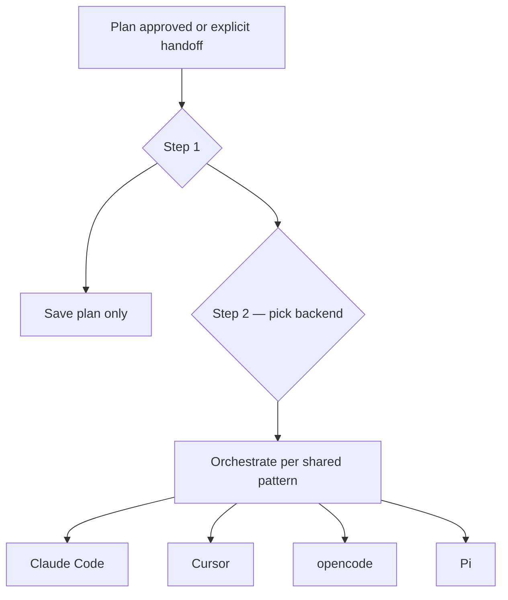

# plan-to-agents

Route approved plans and explicit delegation requests to implementer agents across **four harnesses**: [Claude Code](https://docs.anthropic.com/en/docs/claude-code), [Cursor](https://cursor.com), [opencode](https://opencode.ai), and [Pi](https://pi.dev). One shared plan format in `docs/plans/`; one two-step dispatch flow; per-harness packaging only where discovery differs.

## Four-harness capability matrix

| Harness | Reusable unit | Subagents | Plan trigger | Local delegate | Packaging |
|---------|---------------|-----------|--------------|----------------|-----------|
| **Claude Code** | skills + hooks | native subagents / `agent` CLI | `ExitPlanMode` hook → `plan-dispatch` skill | shell-out per [`shared/dispatch-adapters.md`](shared/dispatch-adapters.md) | marketplace plugin (`/plugin install`) |
| **Cursor** | skills + hooks | native `Task` subagents | `afterFileEdit` sync + explicit `implement-plan` / `agent-handoff` | `Task` tool in-session | marketplace plugin (`/plugin install`) |
| **opencode** | `commands/` + `agents/` markdown | native `Task` subagents | `/plan-dispatch` command (no plan-approved event) | `opencode run -m <model>` headless | [`opencode/install-opencode.sh`](opencode/install-opencode.sh) symlinks into one discovery scope |
| **Pi** | Agent Skills (`skills/`) | `bash`-to-agent / `pi --mode rpc` | `plan-dispatch` skill (no plan-approved event) | RPC JSONL or `pi -p` print mode | top-level `package.json` `pi` key → `pi install git:…@<sha>` |

Canonical role bodies and orchestration prose live in [`shared/`](shared/) (not auto-discovered by any harness). [`shared/emit.sh`](shared/emit.sh) regenerates Claude/Cursor `agents/*.md` and opencode `opencode/agents/*.md` from `shared/roles/`; [`.github/workflows/emit-check.yml`](../../.github/workflows/emit-check.yml) runs `emit.sh` in CI and fails if generated files drift.

## Two-step dispatch flow

Post-approval (`plan-dispatch`) and explicit handoff (`agent-handoff`) both use the same choices:

**Step 1 — what to do with the plan**

1. **Save plan only** — keep the committed plan in `docs/plans/`, no implementation
2. **Dispatch to agent for orchestration** — split the plan and delegate to a doer backend

**Step 2 — pick doer backend** (dispatch only)

- **Claude Code** · **Cursor** · **opencode** · **Pi**

When the chosen backend matches the current harness, orchestrate **in-session** (native subagents, `Task`, etc.). When it differs, **shell out** using the headless column in [`shared/dispatch-adapters.md`](shared/dispatch-adapters.md). Follow [`shared/orchestration-pattern.md`](shared/orchestration-pattern.md) for branch/worktree-per-subtask, verify, merge, and report.



## Canonical plan location: `docs/plans/`

Approved plans are committed at `<repo>/docs/plans/YYYY-MM-DD-<descriptive-name>.md` — harness-neutral, git-tracked, shared across all four backends.

| Host | Harness-global write dir | Repo mirror | Mechanism |
|------|--------------------------|-------------|-----------|
| Claude Code | Claude harness global plans dir | `docs/plans/` | `save-plan-to-repo.sh` on `ExitPlanMode` |
| Cursor | `~/.cursor/plans/` | `docs/plans/` | `sync-plan-to-workspace.sh` on `afterFileEdit` |
| opencode | — | `docs/plans/` | `/plan` command writes directly; `/plan-dispatch` reads from here |
| Pi | — | `docs/plans/` | `planning` / `plan-dispatch` skills target this path |

Filename convention and frontmatter: [`skills/planning/plan-template.md`](skills/planning/plan-template.md).

---

## Install

### Claude Code and Cursor (marketplace)

```text
/plugin marketplace add https://github.com/joemocode-business/joemocode-llm-plugins
/plugin install plan-to-agents@joemocode-llm-plugins
```

Cursor requires the full `https://github.com/...` URL; `owner/repo` shorthand is Claude Code only. Restart after install.

Updates: `/plugin marketplace update joemocode-llm-plugins` then `/plugin update plan-to-agents@joemocode-llm-plugins`.

### opencode

From the repo root (project scope):

```bash
bash plugins/plan-to-agents/opencode/install-opencode.sh
```

Global scope (`~/.config/opencode/`):

```bash
bash plugins/plan-to-agents/opencode/install-opencode.sh --global
```

Use **exactly one** scope (project or global, not both). The installer symlinks agents, commands, and `plan-to-agents-shared/` (orchestration + dispatch docs) into that scope. opencode's `"plugin": [...]` npm array loads JS/TS hooks only — it cannot ship markdown agents or slash commands, so this repo uses symlinks (or optional inline `opencode.json` `{file:...}` fragments — never both for the same definitions). See [docs/pidev-setup.md](../../docs/pidev-setup.md#plan-to-agents--opencode).

Commands after install: `/plan`, `/plan-dispatch`, `/implement-plan`, `/agent-handoff`.

### Pi

Pin a ref and install from the top-level `package.json` `pi` key:

```bash
pi install git:github.com/joemocode-business/joemocode-llm-plugins@<sha-or-tag>
```

Use this **single install route** only — do not also symlink the same skills into `~/.claude/skills` or they double-load. See [docs/pidev-setup.md](../../docs/pidev-setup.md#plan-to-agents--pi).

---

## Components

| Type | File | Role |
|------|------|------|
| **Shared** | `shared/roles/*.md` | Canonical subagent role bodies (source, not discovered) |
| **Shared** | `shared/orchestration-pattern.md` | Backend-neutral split → dispatch → verify → merge |
| **Shared** | `shared/dispatch-adapters.md` | In-session vs headless command per backend |
| **Shared** | `shared/emit.sh` | Regenerate harness-specific agent wrappers from roles |
| **Hook** | `hooks/save-plan-to-repo.sh` | Claude: copy plan → `docs/plans/` on approval |
| **Hook** | `hooks/plan-dispatch.sh` | Claude: steer to `plan-dispatch` after approval |
| **Hook** | `hooks/sync-plan-to-workspace.sh` | Cursor: mirror plan edits → `docs/plans/` |
| **Skill** | `skills/plan-dispatch/SKILL.md` | Two-step post-approval dispatch |
| **Skill** | `skills/implement-plan/SKILL.md` | Phase-based Task orchestration + verification |
| **Skill** | `skills/agent-handoff/SKILL.md` | Explicit delegation without plan approval |
| **Skill** | `skills/planning/SKILL.md` | Plan writing conventions + frontmatter |
| **Agent** | `agents/plan-phase-implementer.md` | Implements one phase/group (generated) |
| **Agent** | `agents/plan-verifier.md` | Verifies acceptance criteria from the diff |
| **opencode** | `opencode/commands/*.md` | Slash commands for plan / dispatch / implement / handoff |
| **opencode** | `opencode/agents/*.md` | Subagent definitions (generated) |
| **opencode** | `opencode/install-opencode.sh` | Symlink installer into one discovery scope |

---

## Skills

### `planning` (all harnesses that load skills)

Guides plan writing. Filename `YYYY-MM-DD-<descriptive-name>.md`; frontmatter `title`, `created`, `last_updated`, `status`. Template: [`skills/planning/plan-template.md`](skills/planning/plan-template.md).

### `plan-dispatch` (Claude, Pi)

After plan approval (Claude via hook; Pi via explicit skill invocation). Two-step choice: save only, or dispatch then pick backend.

**Opt out of dispatch prompt** (save hook still runs):

```bash
export CLAUDE_NO_COMPOSER_DELEGATE=1
```

### `implement-plan` (Cursor, explicit)

Slash or explicit invocation only. Orchestrates phase extraction, parallel `plan-phase-implementer` Tasks, `plan-verifier`, and a fix loop.

### `agent-handoff` (Claude, Cursor, Pi)

Natural-language triggers for ad-hoc delegation: "hand off to agent", "delegate to composer", etc.

---

## Required permissions

| Platform | Permission | Why |
|----------|------------|-----|
| Claude Code | `Bash(agent:*)` | Headless Cursor dispatch (`agent -p --model composer-2.5`) |
| Claude Code | `Bash(cursor-agent:*)` | Alternate Cursor CLI name on some installs |
| Claude Code | `Bash(opencode:*)` | Headless opencode dispatch (`opencode run -m <model>`) |
| Claude Code | `Bash(pi:*)` | Headless Pi dispatch (`pi --mode rpc`, `pi -p`) |

Add to `~/.claude/settings.json` → `permissions.allow`. On Cursor, the `Task` tool is built-in. opencode and Pi need their CLIs on `PATH` when used as headless targets from another harness.

---

## Migration from global `~/.claude` hooks

If you previously installed plan-dispatch hooks globally, remove duplicates after installing this plugin.

1. Delete `hooks.PostToolUse` entries for `save-plan-to-repo.sh` and `plan-dispatch.sh` from `~/.claude/settings.json` (the plugin registers them via `hooks/hooks.json`).
2. `rm -rf ~/.claude/skills/plan-dispatch`
3. Keep the Bash permissions above.
4. Restart Claude Code.

---

## Planning harness suitability (with Plannotator)

[Plannotator](https://github.com/backnotprop/plannotator) provides interactive plan review before approval. Per [Plannotator's installation docs](https://plannotator.ai/docs/getting-started/installation/), native Plan Mode hooks ship for **Claude Code** and **opencode** — these are the best harnesses for drafting and reviewing plans with Plannotator before dispatch.

| Harness | Plan Mode + Plannotator hooks | Notes |
|---------|------------------------------|-------|
| **Claude Code** | Yes | `/plugin install plannotator@plannotator` |
| **opencode** | Yes | `"plugin": ["@plannotator/opencode@latest"]` in `opencode.json` |
| **Cursor** | Partial | Plannotator skills only; no Plan Mode hook plugin yet |
| **Pi** | Partial | Plannotator lists Pi support; use explicit `/plan` or `planning` skill for `docs/plans/` |

Any harness can **implement** an approved plan from `docs/plans/` via plan-to-agents dispatch; the table above is about where to **write and review** plans interactively.

## Plannotator (recommended)

[Plannotator](https://github.com/backnotprop/plannotator) handles interactive plan review before approval. This plugin handles **post-approval routing** only.

```text
/plugin marketplace add backnotprop/plannotator
/plugin install plannotator@plannotator
```

No conflicts — install both independently. See the [marketplace README](../../README.md) for Cursor skill symlinks.

---

## Test checklist

### Claude Code

- [ ] Install plugin; remove global hook/skill duplicates; restart
- [ ] Plan Mode → approve → plan in `docs/plans/`
- [ ] Two-step dispatch (save only / dispatch → four backends)
- [ ] `CLAUDE_NO_COMPOSER_DELEGATE=1` skips dispatch prompt; save hook still runs

### Cursor

- [ ] Install plugin; plan edit syncs to `docs/plans/`
- [ ] `implement-plan` and `agent-handoff` spawn Task subagents

### opencode

- [ ] `install-opencode.sh` (one scope); `/plan`, `/plan-dispatch`, `/implement-plan` listed once
- [ ] `/implement-plan` on a small plan → subagents + verifier

### Pi

- [ ] `pi install git:…@<sha>`; skills load once (no `~/.claude/skills` duplicate)
- [ ] Small plan dispatches via RPC/`bash` adapter

### Cross-harness

- [ ] Plan in opencode → implement from Cursor or Pi using the same `docs/plans/*.md`

---

## Environment variables

| Variable | Default | Effect |
|----------|---------|--------|
| `CLAUDE_NO_COMPOSER_DELEGATE` | `0` | `1` skips post-approval dispatch prompt; save hook still copies the plan |
| `CURSOR_PLAN_SYNC_DEBUG` | unset | Log plan mirror copies to stderr |

---

## Out of scope (v1)

- Cursor auto-prompt on plan approval (no proven `ExitPlanMode` equivalent)
- opencode/Pi auto-dispatch on plan write (explicit `/plan-dispatch` or skill only)

Project-level agent overrides in `<repo>/.cursor/agents/` take priority over the plugin's bundled agents.
