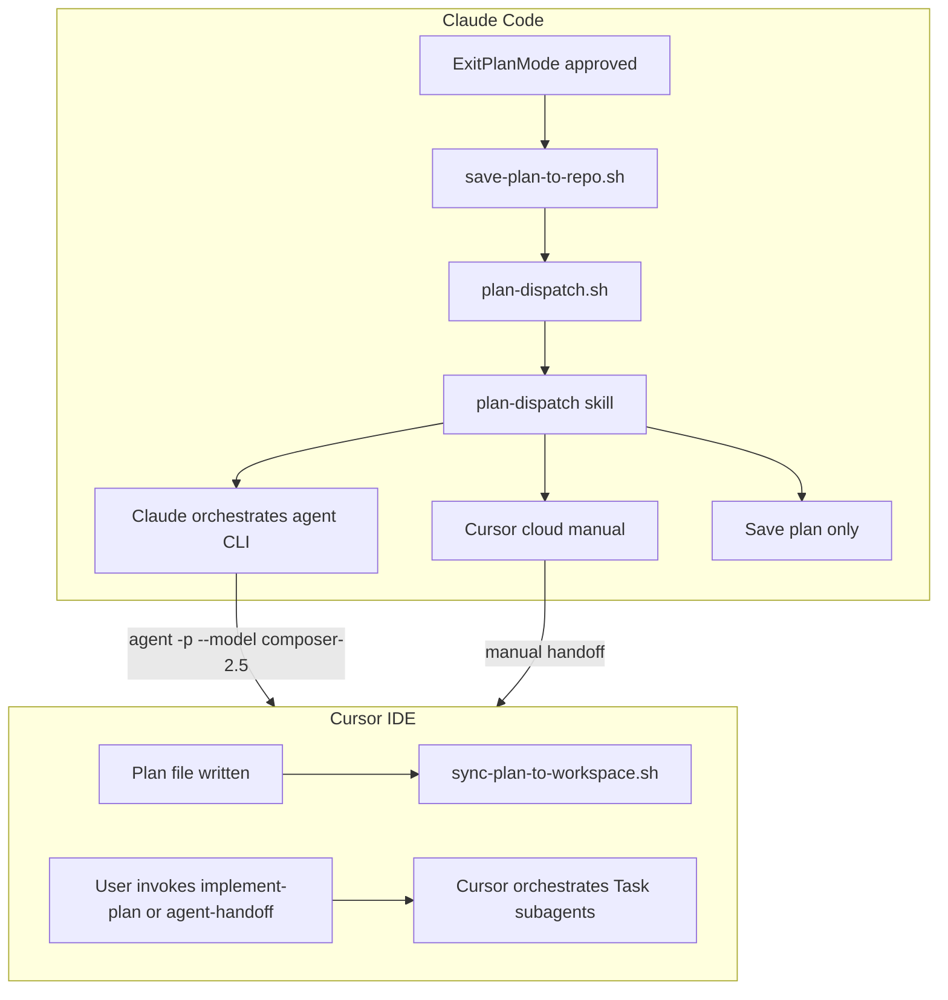

# plan-to-agents

Route approved plans and explicit delegation requests to implementer agents. Works on both [Claude Code](https://docs.anthropic.com/en/docs/claude-code) and [Cursor](https://cursor.com) from a single plugin install.

## What it does

| Flow | Platform | Trigger | Behavior |
|------|----------|---------|----------|
| **Post-approval dispatch** | Claude Code | `ExitPlanMode` (plan approved) | Hooks save the plan to the repo and steer Claude to invoke `plan-dispatch` — a 3-way choice: Cursor cloud (manual), Cursor local via `agent` CLI (Claude orchestrates), or save plan only |
| **Plan implementation** | Cursor | Explicit: "implement this plan" + path | `implement-plan` skill orchestrates `plan-phase-implementer` and `plan-verifier` subagents |
| **Explicit handoff** | Both | Natural language: "hand off to agent", "delegate to composer", etc. | `agent-handoff` skill parses the task, asks local vs cloud, dispatches, and verifies |



---

## Components

| Type | File | Role |
|------|------|------|
| **Hook** | `hooks/save-plan-to-repo.sh` | Claude: copies latest `~/.claude/plans/*.md` → `<repo>/.claude/plans/` on plan approval |
| **Hook** | `hooks/plan-dispatch.sh` | Claude: injects context after approval so Claude invokes `plan-dispatch` instead of implementing directly |
| **Hook** | `hooks/sync-plan-to-workspace.sh` | Cursor: mirrors writes under `~/.cursor/plans/` or `~/.claude/plans/` → `<repo>/.cursor/plans/` |
| **Hook config** | `hooks/hooks.json` | Claude `PostToolUse` matcher for `ExitPlanMode` |
| **Hook config** | `hooks/hooks-cursor.json` | Cursor `afterFileEdit` plan sync |
| **Skill** | `skills/plan-dispatch/SKILL.md` | Claude-primary: 3-way post-approval dispatch |
| **Skill** | `skills/implement-plan/SKILL.md` | Cursor-primary: phase-based Task orchestration + verification |
| **Skill** | `skills/agent-handoff/SKILL.md` | Both: explicit delegation without plan approval |
| **Agent** | `agents/plan-phase-implementer.md` | Implements one phase/group from a plan file |
| **Agent** | `agents/plan-verifier.md` | Verifies acceptance criteria from the diff |

---

## Prerequisites

### Claude Code

```bash
curl -fsSL https://claude.ai/install.sh | bash   # macOS / Linux / WSL
claude --version
```

Windows: `irm https://claude.ai/install.ps1 | iex`. See [Claude Code quickstart](https://code.claude.com/docs/en/quickstart).

### Cursor Agent CLI

Required when Claude orchestrates local implementation (Branch C of `plan-dispatch`):

```bash
curl https://cursor.com/install -fsS | bash
echo 'export PATH="$HOME/.local/bin:$PATH"' >> ~/.zshrc && source ~/.zshrc
agent --version
```

Windows: `irm 'https://cursor.com/install?win32=true' | iex`. See [Cursor CLI installation](https://cursor.com/docs/cli/installation).

---

## Install

### Claude Code

```text
/plugin marketplace add joemocode-business/joemocode-llm-plugins
/plugin install plan-to-agents@joemocode-llm-plugins
```

### Cursor

```text
/plugin marketplace add joemocode-business/joemocode-llm-plugins
/plugin install plan-to-agents@joemocode-llm-plugins
```

Restart the host after installing so hooks and skills load.

---

## Migration from global `~/.claude` hooks

If you previously installed plan-dispatch hooks globally, remove the duplicates after installing this plugin.

### 1. Remove global hooks from `~/.claude/settings.json`

Delete the `hooks.PostToolUse` entries that reference `save-plan-to-repo.sh` and `plan-dispatch.sh`:

```json
// REMOVE this block from ~/.claude/settings.json:
"hooks": {
  "PostToolUse": [
    {
      "matcher": "ExitPlanMode",
      "hooks": [
        { "type": "command", "command": "~/.claude/hooks/save-plan-to-repo.sh", ... },
        { "type": "command", "command": "~/.claude/hooks/plan-dispatch.sh", ... }
      ]
    }
  ]
}
```

The plugin registers the same hooks via `hooks/hooks.json` using `${CLAUDE_PLUGIN_ROOT}` paths.

### 2. Remove global skill

```bash
rm -rf ~/.claude/skills/plan-dispatch
```

The plugin ships its own copy under `skills/plan-dispatch/`.

### 3. Keep required permissions

Ensure `~/.claude/settings.json` still allows the Cursor `agent` CLI:

```json
"permissions": {
  "allow": ["Bash(agent:*)", "Bash(cursor-agent:*)"]
}
```

### 4. Restart Claude Code

Restart the session so the plugin hooks load and global duplicates are gone.

---

## Required permissions

| Platform | Permission | Why |
|----------|------------|-----|
| Claude Code | `Bash(agent:*)` | `plan-dispatch` Branch C and `agent-handoff` dispatch `composer-2.5` via the Cursor `agent` CLI |
| Claude Code | `Bash(cursor-agent:*)` | Alternate CLI name on some installs |

Add to `~/.claude/settings.json` → `permissions.allow` (see migration section above).

On Cursor, the `Task` tool is built-in; no extra CLI permissions are needed for `implement-plan` or `agent-handoff`.

---

## Plan storage

| Host | Global plans dir | Repo mirror | Mechanism |
|------|------------------|-------------|-----------|
| Claude Code | `~/.claude/plans/` | `<repo>/.claude/plans/` | `save-plan-to-repo.sh` on `ExitPlanMode` approval |
| Cursor | `~/.cursor/plans/` | `<repo>/.cursor/plans/` | `sync-plan-to-workspace.sh` on `afterFileEdit` |

Recommend git-tracking repo plan directories so approved plans travel with the codebase.

**Debug sync:** set `CURSOR_PLAN_SYNC_DEBUG=1` to log mirror copies to stderr:

```bash
export CURSOR_PLAN_SYNC_DEBUG=1
```

---

## Skills

### `plan-dispatch` (Claude)

Triggered automatically after plan approval (via hook context injection). Presents three options:

1. **Cursor cloud (manual)** — hand off to https://cursor.com/agents
2. **Cursor local — Claude orchestrates** — Claude splits the plan and dispatches `agent -p --model composer-2.5`
3. **Save plan only** — keep the saved plan, no implementation

**Opt out of dispatch prompt** (save hook still runs):

```bash
export CLAUDE_NO_COMPOSER_DELEGATE=1
```

### `implement-plan` (Cursor, explicit)

Slash or explicit invocation only (`disable-model-invocation: true`). Say "implement this plan" with a `.md` path.

Orchestrates:

1. Phase extraction and size classification
2. Parallel `plan-phase-implementer` Tasks for independent phase groups
3. `plan-verifier` Task for acceptance criteria check
4. Fix loop if verifier reports failures

### `agent-handoff` (both, explicit)

Natural-language triggers enabled (`disable-model-invocation: false`). Use for ad-hoc delegation without Plan Mode:

- "hand off to agent"
- "delegate to composer"
- "run this in a subagent"

Parses task goal, files, and acceptance criteria; asks local subagent vs Cursor cloud vs cancel; dispatches and verifies via `git diff`.

| Platform | Local dispatch |
|----------|----------------|
| Claude Code | `agent -p --force --trust --model composer-2.5 --workspace "<CWD>" "<prompt>"` |
| Cursor | `Task` tool with `generalPurpose` or `plan-phase-implementer` |

---

## Plannotator (recommended)

[Plannotator](https://github.com/backnotprop/plannotator) handles interactive plan review before approval. This plugin handles **post-approval routing** only. Use both for the full workflow:

1. **Plannotator** — annotate, refine, approve or request changes in the browser
2. **plan-to-agents** — save the approved plan to the repo and dispatch implementation

### Install Plannotator

**CLI** (required by both Claude Code and Cursor):

```bash
curl -fsSL https://plannotator.ai/install.sh | bash   # macOS / Linux / WSL
```

```powershell
irm https://plannotator.ai/install.ps1 | iex            # Windows PowerShell
```

**Claude Code plugin** (automatic Plan Mode hooks on `ExitPlanMode`):

```text
/plugin marketplace add backnotprop/plannotator
/plugin install plannotator@plannotator
```

Restart Claude Code. The installer also places skills under `~/.claude/skills/` (`plannotator-annotate`, `plannotator-review`, etc.).

**Cursor** (skills only — no Plan Mode hook plugin yet):

```bash
mkdir -p ~/.cursor/skills
for skill in plannotator-annotate plannotator-review plannotator-last plannotator-setup-goal; do
  ln -sf ~/.claude/skills/"$skill" ~/.cursor/skills/"$skill"
done
```

Restart Cursor. Invoke review/annotate skills explicitly, or run `plannotator annotate <path>` from the terminal. After you approve a plan, use `implement-plan` or `agent-handoff` from this plugin.

No conflicts between the two plugins — install both independently.

---

## Test checklist

### Prerequisites

- [ ] `claude --version` works (Claude Code native install)
- [ ] `agent --version` works (Cursor Agent CLI — needed for Claude→Composer dispatch)
- [ ] `plannotator --version` works; Plannotator plugin installed in Claude Code (optional but recommended)

### Claude Code

- [ ] `/plugin marketplace add` + `/plugin install plan-to-agents@joemocode-llm-plugins`
- [ ] Remove global hooks from `~/.claude/settings.json` and `~/.claude/skills/plan-dispatch/`; restart Claude Code
- [ ] Enter Plan Mode → approve plan → confirm plan copied to `<repo>/.claude/plans/`
- [ ] Confirm `plan-dispatch` skill invoked (3-way question)
- [ ] Branch C: confirm `agent` CLI dispatch works with `Bash(agent:*)` permission
- [ ] `CLAUDE_NO_COMPOSER_DELEGATE=1` → normal Claude implementation (save hook still runs)

### Cursor

- [ ] Install same marketplace plugin in Cursor
- [ ] Plan Mode: edit plan → confirm sync to `<repo>/.cursor/plans/`
- [ ] Explicit: "implement this plan" with path → `implement-plan` spawns subagents
- [ ] Explicit: "hand off this refactor to a subagent" → `agent-handoff` works

### Cross-platform

- [ ] Plan approved in Claude, choose Cursor local → composer implements
- [ ] Plan created in Cursor, implement via `implement-plan` without Claude involved

---

## Environment variables

| Variable | Default | Effect |
|----------|---------|--------|
| `CLAUDE_NO_COMPOSER_DELEGATE` | `0` | Set to `1` to skip the post-approval dispatch prompt; Claude implements normally. Save hook still copies the plan. |
| `CURSOR_PLAN_SYNC_DEBUG` | unset | Set to any value to log plan mirror copies (`<source> -> <dest>`) to stderr |

---

## Out of scope (v1)

- Cursor auto-prompt on plan approval (no proven `ExitPlanMode` equivalent)
- Cursor cloud agent CLI automation (manual handoff at https://cursor.com/agents)
- Cursor SDK (`@cursor/sdk`) for programmatic cloud agent launch

Project-level agent overrides in `<repo>/.cursor/agents/` take priority over the plugin's bundled agents.
