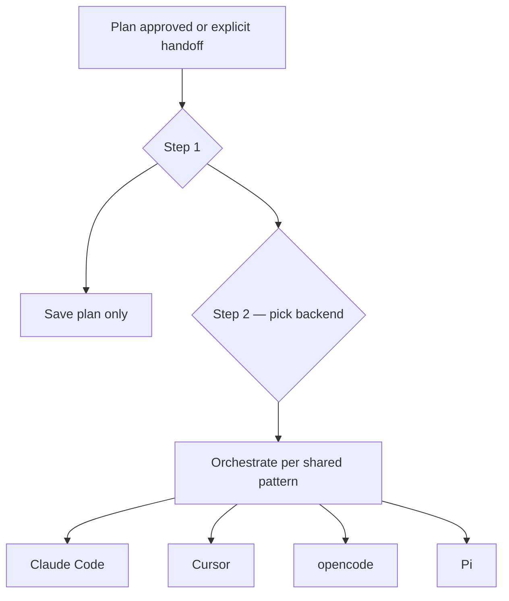

# plan-to-agents

Route approved plans and explicit delegation requests to implementer agents across **four harnesses**: [Claude Code](https://docs.anthropic.com/en/docs/claude-code), [Cursor](https://cursor.com), [opencode](https://opencode.ai), and [Pi](https://pi.dev). One shared plan format in `docs/plans/`; one two-step dispatch flow; per-harness packaging only where discovery differs.

## Four-harness capability matrix

| Harness | Reusable unit | Subagents | Plan trigger | Local delegate | Packaging |
|---------|---------------|-----------|--------------|----------------|-----------|
| **Claude Code** | skills + hooks | native subagents / `agent` CLI | `ExitPlanMode` hook → `plan-dispatch` skill | shell-out per [`shared/dispatch-adapters.md`](shared/dispatch-adapters.md) | marketplace plugin (`/plugin install`) |
| **Cursor** | skills + hooks | native `Task` subagents | `afterFileEdit` sync + explicit `implement-plan` / `agent-handoff` | `Task` tool in-session | marketplace plugin (`/plugin install`) |
| **opencode** | native skills + `agents/` | `task` tool | built-in Plan agent + `/planning`; `/plan-dispatch` explicit (no plan-approved event) | `task` in-session | [`opencode/install-opencode.sh`](opencode/install-opencode.sh) symlinks skills + agents into one scope |
| **Pi** | skills + extensions + prompts | `subagent` tool + `pi/agents/*.md` | `/plan-dispatch` prompt (no plan-approved event) | `subagent` tool or RPC/`bash` | top-level `package.json` `pi` key → `pi install git:…@<sha>` |

Canonical role bodies and orchestration prose live in [`shared/`](shared/) (not auto-discovered by any harness). [`shared/emit.sh`](shared/emit.sh) regenerates Claude/Cursor `agents/*.md`, opencode `opencode/agents/*.md`, and Pi `pi/agents/*.md` from `shared/roles/`; [`.github/workflows/emit-check.yml`](../../.github/workflows/emit-check.yml) runs `emit.sh` in CI and fails if generated files drift.

## Two-step dispatch flow

Post-approval (`plan-dispatch`) and explicit handoff (`agent-handoff`) both use the same choices:

**Step 1 — what to do with the plan**

1. **Save plan only** — keep the committed plan in `docs/plans/`, no implementation
2. **Dispatch to agent for orchestration** — split the plan and delegate to a doer backend

**Step 2 — pick doer backend** (dispatch only)

- **Claude Code** · **Cursor** · **opencode** · **Pi**

When the chosen backend matches the current harness, orchestrate **in-session** (native subagents, `Task`, `task`, or `subagent`). When it differs, **shell out** using the headless column in [`shared/dispatch-adapters.md`](shared/dispatch-adapters.md). Follow [`shared/orchestration-pattern.md`](shared/orchestration-pattern.md) for branch/worktree-per-subtask, verify, merge, and report.



## Canonical plan location: `docs/plans/`

Approved plans are committed at `<repo>/docs/plans/YYYY-MM-DD-<descriptive-name>.md` — harness-neutral, git-tracked, shared across all four backends.

| Host | Harness-global write dir | Repo mirror | Mechanism |
|------|--------------------------|-------------|-----------|
| Claude Code | Claude harness global plans dir | `docs/plans/` | `save-plan-to-repo.sh` on `ExitPlanMode` |
| Cursor | `~/.cursor/plans/` | `docs/plans/` | `sync-plan-to-workspace.sh` on `afterFileEdit` |
| opencode | — | `docs/plans/` | built-in Plan agent + `/planning` skill; `/plan-dispatch` reads from here |
| Pi | — | `docs/plans/` | `planning` skill or `/plan-dispatch` prompt |

Filename convention and frontmatter: [`skills/planning/plan-template.md`](skills/planning/plan-template.md).

---

## Install

### Claude Code and Cursor (marketplace)

```text
/plugin marketplace add https://github.com/joemocode-business/joemocode-llm-plugins
/plugin install plan-to-agents@joemocode-llm-plugins
```

Cursor requires the full `https://github.com/...` URL; `owner/repo` shorthand is Claude Code only. Restart after install.

Updates: `/plugin marketplace update joemocode-llm-plugins` then `/plugin update plan-to-agents@joemocode-llm-plugins`.

**Cursor runtime checks (manual):** after install from git path or Team Marketplace, confirm `afterFileEdit` mirrors `~/.cursor/plans/` into `docs/plans/`, and that `implement-plan` / `agent-handoff` spawn `Task` subagents. There is no proven Cursor hook equivalent to Claude's `ExitPlanMode` dispatch prompt.

### opencode

From the repo root (project scope):

```bash
bash plugins/plan-to-agents/opencode/install-opencode.sh
```

Global scope (`~/.config/opencode/`):

```bash
bash plugins/plan-to-agents/opencode/install-opencode.sh --global
```

Use **exactly one** scope (project or global, not both). The installer symlinks six skills, two generated agents, and `plan-to-agents-shared/` orchestration docs into that scope. It does **not** install a `commands/` directory. Reinstall removes stale command symlinks from older releases.

opencode's `"plugin": [...]` npm array loads JS/TS hooks only. It cannot ship markdown agents or skills, so this repo uses symlinks (or optional inline `opencode.json` `{file:...}` fragments — never both for the same definitions). See [docs/pidev-setup.md](../../docs/pidev-setup.md#plan-to-agents--opencode).

**Planner workflow:** switch to opencode's built-in Plan primary agent, then invoke `/planning`. There is no `/plan` command.

**Skills after install:** `/planning`, `/plan-dispatch`, `/implement-plan`, `/configure`, `/agent-handoff`, `/clear-plans`.

**Interactive tools:** skills use opencode's native `question` tool for choices and `task` for `plan-phase-implementer` / `plan-verifier`.

**Permission config:** merge [`opencode/opencode.json.example`](opencode/opencode.json.example) into your `opencode.json` so explicit-only skills (`implement-plan`, `configure`, `clear-plans`) stay denied until invoked. The installer never overwrites an existing config.

Validate a local install: `bash plugins/plan-to-agents/opencode/validate-install.sh`.

### Pi

Pin a ref and install from the top-level `package.json` `pi` key:

```bash
pi install git:github.com/joemocode-business/joemocode-llm-plugins@<sha-or-tag>
```

Use this **single install route** only. Do not also symlink the same skills into `~/.claude/skills` or they double-load. See [docs/pidev-setup.md](../../docs/pidev-setup.md#plan-to-agents--pi).

**Package contents:** six skills (from both plugins), three TypeScript extensions (`question`, `subagent`, and session-handoff's compaction guard), four prompt templates under `pi/prompts/`, and generated `pi/agents/*.md` for the `subagent` tool.

**Prompt templates:** `/plan-dispatch`, `/implement-plan`, `/configure`, `/clear-plans`.

**Delegation:** `subagent` spawns isolated Pi child sessions using package-local `pi/agents/*.md`. Project-local `.pi/agents/` loads only when `agentScope` is `project` or `both` and the user confirms for trusted repos. Live dispatch needs working provider credentials on the machine.

---

## Model configuration

Dispatch can use a default model per doer harness so orchestration does not probe or ask every time. Configuration is layered JSON; **first match wins**:

1. **Repo override** — `<repo-root>/.plan-to-agents.json` (optional; gitignorable local override)
2. **User default** — `${XDG_CONFIG_HOME:-~/.config}/plan-to-agents/config.json` (per-machine default)
3. **Neither present** — dispatch asks the user which model to use

Top-level fields shallow-merge with the repo override winning; the `harnesses` map merges
**per-slug and per-field**, so a repo override of one harness does not drop the user file's other
harness entries.

Add `.plan-to-agents.json` to `.gitignore` if you use the repo override — it is meant for local or per-project preferences, not committed defaults.

Check a hand-edited config with `bash plugins/plan-to-agents/shared/validate-config.sh <path>`.

| Field | Purpose |
|-------|---------|
| `enabled_harnesses` | Harnesses this install uses (subset of canonical slugs) |
| `harnesses.<slug>.default_model` | Default model slug for that harness |
| `harnesses.<slug>.models` | Optional allowlist of models for that harness |

Canonical harness slugs: `claude-code`, `cursor`, `opencode`, `pi`.

Reference: [`config.example.json`](config.example.json) for a full example; [`shared/model-resolution.md`](shared/model-resolution.md) for how dispatch resolves models from config.

**Setup:** `/plan-to-agents:configure` on Claude Code and Cursor; `/configure` skill on opencode; `/configure` prompt on Pi.

---

## Components

| Type | File | Role |
|------|------|------|
| **Shared** | `shared/roles/*.md` | Canonical subagent role bodies (source, not discovered) |
| **Shared** | `shared/orchestration-pattern.md` | Backend-neutral split → dispatch → verify → merge |
| **Shared** | `shared/dispatch-adapters.md` | In-session vs headless command per backend |
| **Shared** | `shared/emit.sh` | Regenerate harness-specific agent wrappers from roles |
| **Hook** | `hooks/save-plan-to-repo.sh` | Claude: copy plan → `docs/plans/` on approval |
| **Hook** | `hooks/plan-dispatch.sh` | Claude: steer to `plan-dispatch` after approval |
| **Hook** | `hooks/sync-plan-to-workspace.sh` | Cursor: mirror plan edits → `docs/plans/` |
| **Skill** | `skills/plan-dispatch/SKILL.md` | Two-step post-approval dispatch |
| **Skill** | `skills/implement-plan/SKILL.md` | Phase-based orchestration + verification |
| **Skill** | `skills/agent-handoff/SKILL.md` | Explicit delegation without plan approval |
| **Skill** | `skills/planning/SKILL.md` | Plan writing conventions + frontmatter |
| **Skill** | `skills/configure/SKILL.md` | Per-harness model defaults (explicit-only) |
| **Skill** | `skills/clear-plans/SKILL.md` | Archive or delete old plans (explicit-only) |
| **Agent** | `agents/plan-phase-implementer.md` | Implements one phase/group (generated) |
| **Agent** | `agents/plan-verifier.md` | Verifies acceptance criteria from the diff |
| **opencode** | `opencode/install-opencode.sh` | Symlink installer for skills + agents |
| **opencode** | `opencode/opencode.json.example` | `permission.skill` and `permission.task` denies |
| **Pi** | `pi/extensions/question.ts` | `question` tool for multi-choice prompts |
| **Pi** | `pi/extensions/subagent/` | `subagent` tool; discovers `pi/agents/*.md` |
| **Pi** | `pi/prompts/*.md` | User-invoked dispatch/configure/clear templates |
| **Pi** | `pi/agents/*.md` | Generated subagent bodies for `subagent` tool |

---

## Skills

### `planning` (all harnesses that load skills)

Guides plan writing. Filename `YYYY-MM-DD-<descriptive-name>.md`; frontmatter `title`, `created`, `last_updated`, `status`. Template: [`skills/planning/plan-template.md`](skills/planning/plan-template.md).

On opencode, use with the built-in Plan primary agent. On Pi, invoke the skill or follow `/plan-dispatch` after the plan is ready.

### `plan-dispatch` (Claude, opencode, Pi)

After plan approval (Claude via hook; opencode and Pi via explicit skill or prompt). Two-step choice: save only, or dispatch then pick backend.

**Opt out of dispatch prompt** (save hook still runs):

```bash
export CLAUDE_NO_COMPOSER_DELEGATE=1
```

### `implement-plan` (Claude, Cursor, opencode, Pi)

Explicit invocation only; **requires a plan file path** (e.g. `/implement-plan docs/plans/2026-07-09-foo.md`). Orchestrates phase extraction, parallel implementer subagents, merge, verifier, and a fix loop. Uses `Task` on Claude/Cursor, `task` on opencode, `subagent` on Pi.

### `agent-handoff` (Claude, Cursor, opencode, Pi)

Natural-language triggers for ad-hoc delegation: "hand off to agent", "delegate to composer", etc.

### `configure` and `clear-plans` (explicit-only)

`/configure` sets per-harness model defaults. `/clear-plans` archives or deletes old `docs/plans/` files. Both are user-invoked; opencode needs `permission.skill` denies from the example config.

---

## Required permissions

| Platform | Permission | Why |
|----------|------------|-----|
| Claude Code | `Bash(agent:*)` | Headless Cursor dispatch (`agent -p --model composer-2.5`) |
| Claude Code | `Bash(cursor-agent:*)` | Alternate Cursor CLI name on some installs |
| Claude Code | `Bash(opencode:*)` | Headless opencode dispatch (`opencode run -m <model>`) |
| Claude Code | `Bash(pi:*)` | Headless Pi dispatch (`pi --mode rpc`, `pi -p`) |

Add to `~/.claude/settings.json` → `permissions.allow`. On Cursor, the `Task` tool is built-in. opencode and Pi need their CLIs on `PATH` when used as headless targets from another harness.

---

## Migration from global `~/.claude` hooks

If you previously installed plan-dispatch hooks globally, remove duplicates after installing this plugin.

1. Delete `hooks.PostToolUse` entries for `save-plan-to-repo.sh` and `plan-dispatch.sh` from `~/.claude/settings.json` (the plugin registers them via `hooks/hooks.json`).
2. `rm -rf ~/.claude/skills/plan-dispatch`
3. Keep the Bash permissions above.
4. Restart Claude Code.

### opencode: migrate from commands to skills

If you installed an older release that symlinked `opencode/commands/*.md`, re-run `install-opencode.sh`. It removes stale command symlinks and links skills instead. Update any muscle memory: `/plan` → built-in Plan agent + `/planning`; `/plan-to-agents:configure` → `/configure`.

---

## Planning harness suitability (with Plannotator)

[Plannotator](https://github.com/backnotprop/plannotator) provides interactive plan review before approval. Per [Plannotator's installation docs](https://plannotator.ai/docs/getting-started/installation/), native Plan Mode hooks ship for **Claude Code** and **opencode** — these are the best harnesses for drafting and reviewing plans with Plannotator before dispatch.

| Harness | Plan Mode + Plannotator hooks | Notes |
|---------|------------------------------|-------|
| **Claude Code** | Yes | `/plugin install plannotator@plannotator` |
| **opencode** | Yes | `"plugin": ["@plannotator/opencode@latest"]` in `opencode.json` |
| **Cursor** | Partial | Plannotator skills only; no Plan Mode hook plugin yet |
| **Pi** | Partial | Plannotator lists Pi support; use `planning` skill or `/plan-dispatch` for `docs/plans/` |

Any harness can **implement** an approved plan from `docs/plans/` via plan-to-agents dispatch; the table above is about where to **write and review** plans interactively.

## Plannotator (recommended)

[Plannotator](https://github.com/backnotprop/plannotator) handles interactive plan review before approval. This plugin handles **post-approval routing** only.

```text
/plugin marketplace add backnotprop/plannotator
/plugin install plannotator@plannotator
```

No conflicts — install both independently. See the [marketplace README](../../README.md) for Cursor skill symlinks.

---

## Test checklist

### Claude Code

- [ ] Install plugin; remove global hook/skill duplicates; restart
- [ ] Plan Mode → approve → plan in `docs/plans/`
- [ ] Two-step dispatch (save only / dispatch → four backends)
- [ ] `CLAUDE_NO_COMPOSER_DELEGATE=1` skips dispatch prompt; save hook still runs

### Cursor

- [ ] Install plugin from git URL or Team Marketplace; plan edit syncs to `docs/plans/`
- [ ] `implement-plan` and `agent-handoff` spawn Task subagents
- [ ] No auto-dispatch on plan approval (explicit skills only)

### opencode

- [ ] `install-opencode.sh` (one scope); six skills and two agents listed once
- [ ] No `commands/` symlinks remain after reinstall
- [ ] `/planning` with Plan agent; `/plan-dispatch` two-step flow
- [ ] `/implement-plan docs/plans/<plan>.md` on a small plan → `task` subagents + verifier
- [ ] `validate-install.sh` passes

### Pi

- [ ] `pi install git:…@<sha>`; skills load once (no `~/.claude/skills` duplicate)
- [ ] `question` and `subagent` tools registered; `pi/agents/*.md` listed
- [ ] `/plan-dispatch` and `/implement-plan` on a small plan
- [ ] Project agents require confirmation when `agentScope` includes project

### Cross-harness

- [ ] Plan in opencode → implement from Cursor or Pi using the same `docs/plans/*.md`

---

## Environment variables

| Variable | Default | Effect |
|----------|---------|--------|
| `CLAUDE_NO_COMPOSER_DELEGATE` | `0` | `1` skips post-approval dispatch prompt; save hook still copies the plan |
| `CURSOR_PLAN_SYNC_DEBUG` | unset | Log plan mirror copies to stderr |

---

## Out of scope (v1)

- Cursor auto-prompt on plan approval (no proven `ExitPlanMode` equivalent)
- opencode/Pi auto-dispatch on plan write (explicit `/plan-dispatch` or skill only)

Project-level agent overrides in `<repo>/.cursor/agents/` take priority over the plugin's bundled agents.
